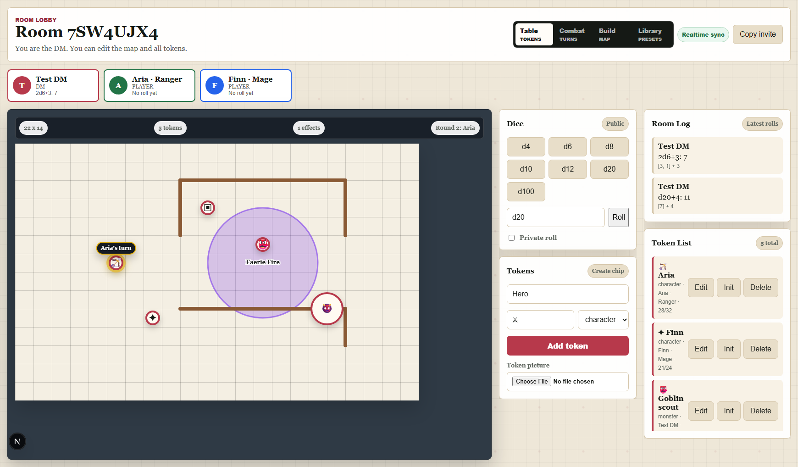

# DND Battle Room

DND Battle Room is pretty much says what it is, it is a self-hosted tabletop for running your sessio nand encounters online together with your group in your browser. U can Prepare a battlefield, invite players with a campaign code, and manage tokens, initiative and dice in one shared room. Connect encounters on a world map and set the mood with shared audio. The features were based on problems or ideas my Group came up with and also closely working with the DM of my Group. important to say is AI was used in the design of the outside of the battle room, but NO PICTURES were Generated with AI and no Art will be Generated with AI. 



- Campaign worlds with connected locations, hidden/revealed areas and separate battle scenes.
- Battlefield backgrounds, calibrated grids, draggable tokens, drawing tools and spell effects.
- Initiative, conditions, turn progression and public or private dice rolls.
- Reusable token/object presets, personal portraits and uploaded campaign audio.
- PostgreSQL saves campaigns, encounters, accounts and dice history. Players follow the DM between the world map and active encounters.
- Phone-friendly player access without creating an account. DMs have separate accounts and campaign ownership.

## Playing together

1. Sign in as a DM (or register with a code from an existing DM), create a campaign and prepare its locations and encounters.
2. Share the campaign invitation or its eight-character code. Players choose a guest name and character.
3. Send players to an encounter, assign their tokens and run the battle together. Players control their own tokens; the DM controls the battlefield and combat progression.

For maps with a printed grid, **Build → Detect printed grid** proposes an alignment; review it and choose **Apply grid alignment**. Manual alignment supports up to 800% preview zoom, scrolling and selecting points several cells apart. A newly imported map starts without a second grid overlay.

Private rolls are visible only to their roller and the campaign DM. DM token notes stay private, and DM-controlled token HP is hidden from players. Guest identity comes from a secure session, never a matching display name.

## Install on your server

###Short Warning
most of the dependencies and Packages used in this Project were Checked and had at this time no vunerabilities.
This could have changed at the time of your Download so always let it check before downloading.

The installer supports **Ubuntu 24.04 servers on x86-64 or ARM64**, with sudo/root access. It installs missing dependencies and reuses a compatible Node.js 24, local PostgreSQL 16+ and Caddy installation. Existing unrelated databases and websites are preserved. No separate panel, daemon or container is needed.

Own a public domain or subdomain. For **Caddy-managed HTTPS**, point its A/AAAA records at the server and allow inbound TCP **80 and 443** through the firewall/router; remove stale AAAA records if IPv6 cannot reach it. For an **existing reverse proxy or Cloudflare Tunnel**, keep that service’s DNS/HTTPS setup and configure its route to Battle Room. The installer does not automatically migrate an older database schema.


```bash
bash <(curl -fsSL https://raw.githubusercontent.com/Darkspiet/DND-Battle-Room/v1.0.0/install.sh)
```

U can also download the source ZIP from GitHub, copy it to the Ubuntu server and extract it. From the extracted project folder u can run its installer against the original ZIP with this cmd:

```bash
bash install.sh --local-archive /absolute/path/DND-Battle-Room-1.0.0-rc.1.zip
```

Local-archive mode still downloads operating-system packages and npm dependencies. Use only a source archive you trust; installation builds and runs its code.

The opening menu offers **install/resume/reinstall**, **uninstall while keeping data**, or exit. Choose Caddy-managed HTTPS or an existing proxy/tunnel, then the installer asks for the website name, domain, first DM username/display name/password, and PostgreSQL database name/user/password. Password entry is hidden and confirmed; database credentials can be generated. It shows a summary with secrets omitted before changing the system.

Open your chosen HTTPS URL and use **DM sign in** with the initial account. It is a regular DM account. Existing DMs generate single-use account invitations from their dashboard. Players use campaign invitations. Operators can enable public DM signup in configuration. There is no application administrator role.

An existing PostgreSQL server can be reused, but a new install needs an unused database name and dedicated username; existing names are never overwritten or reset.

To remove the app, run `bash install.sh --uninstall` (or choose it from the menu). This keeps the database, credentials, uploaded media, protected configuration and shared packages. Reinstalling after uninstall uses the saved settings and accounts; review schema compatibility first. `--install` skips the opening action menu.

A retry of the same installer preserves completed stages, credentials, accounts and saved data. For conflicts, stop and follow the diagnostic message; do not delete PostgreSQL data to force installation.

## Guides

- [Server operations](docs/OPERATIONS.md): configuration, backups, updates and troubleshooting.
- [Development](docs/DEVELOPMENT.md): local setup, tests and code organization.
- [Security](docs/SECURITY.md): credentials, permissions and privacy protections.

MIT licensed; see [LICENSE](LICENSE). npm publication is intentionally disabled.
